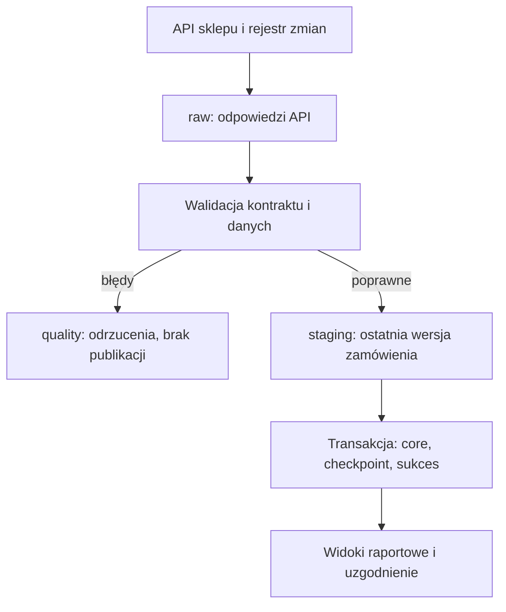

# Orders Data Pipeline

[](https://github.com/Benvenuteo/orders-data-pipeline/actions/workflows/ci.yml)

Pipeline danych zamówień: **API → dane surowe → walidacja → staging → SQL Server**.
Projekt pokazuje pełny import, ładowanie przyrostowe, obsługę usunięć, transakcyjną
publikację i ponowne przetwarzanie danych po awarii. Zawiera też próbę migracji
z zamrożeniem źródła i uzgodnieniem danych przed przełączeniem odczytu.

## Problem i kryteria sukcesu

Firma potrzebuje własnej, aktualizowanej bazy zamówień do raportowania. Import ma
obsługiwać zmiany istniejących zamówień i zachować poprawny stan po awarii.

- Powtórzenie importu nie tworzy duplikatów.
- Nowe wersje aktualizują właściwe zamówienia; usunięcia mają postać tombstone.
- Błędny rekord blokuje publikację całej partii i zostawia przyczynę odrzucenia.
- Dane biznesowe, checkpoint i status sukcesu są zatwierdzane w jednej transakcji.
- Uzgodnienie porównuje identyfikatory, wersje i wszystkie pola, a kwoty osobno dla walut.
- Awarię widać w historii uruchomień, logach i kodzie zakończenia procesu.

Źródłem jest własny sklep testowy z trwałym rejestrem zmian w SQLite.
Identyfikatory klientów są syntetyczne. Jeden wiersz docelowy oznacza jedno
zamówienie w jednej walucie. Kwoty brutto nie obejmują w tym zakresie korekt i zwrotów.
Widok sprzedaży uwzględnia aktywne zamówienia `paid` i `shipped`.

## Uruchomienie na Windows — PowerShell

Wymagania: Git, Docker Desktop z kontenerami Linux, komputer x86-64 i minimum
4 GB RAM przydzielone Dockerowi; 6 GB zapewnia większy zapas. SQL Server Developer
jest tutaj używany do nauki i testów. Porty `8000` i `1433` muszą być wolne.

```powershell
git clone https://github.com/Benvenuteo/orders-data-pipeline.git
cd orders-data-pipeline
# Do czasu scalenia pull requestu:
git switch feat/reliable-orders-pipeline

powershell -NoProfile -ExecutionPolicy Bypass -File .\scripts\init_env.ps1
New-Item -ItemType Directory -Force reports | Out-Null
docker compose build
docker compose up -d --wait sqlserver api
docker compose run --rm bootstrap
docker compose run --rm pipeline demo --output /reports/demo.json
```

Demonstracja wymaga pustego źródła i celu. Nie czyści istniejących danych.
Tworzy **1000 zamówień**, wykonuje import, dodaje 10 zamówień, aktualizuje 5,
oznacza 2 jako usunięte, symuluje awarię przed zatwierdzeniem i odtwarza partię
bez dostępu do API. Następnie zamraża źródło, wykonuje kontrolę migracyjną i je
odmraża. Wynik: **1010 rekordów, 1008 aktywnych i zgodność wszystkich pól**.

Raport zostanie zapisany jako `reports/demo.json`. API: <http://localhost:8000/docs>.
Do operacji w Swaggerze wpisz wartość `API_KEY` z lokalnego `.env` w pole
`x-api-key`. Sekrety generowane są lokalnie; `.env` jest wykluczony z Git.

Na Linux/macOS z Pythonem 3.12+ konfigurację generuje `python scripts/init_env.py`.
Na Linux utwórz `reports` i nadaj katalogowi uprawnienia do zapisu dla UID `10001`
kontenera albo użyj `docker compose run --user "$(id -u):$(id -g)" ...` przy eksporcie.
SQL Server w tej konfiguracji wymaga hosta x86-64.

## Podstawowe operacje

```powershell
docker compose run --rm pipeline run
docker compose run --rm pipeline status
docker compose run --rm pipeline health
docker compose run --rm pipeline reconcile --output /reports/reconciliation.json
```

Alternatywny start na pustym środowisku, z większym zbiorem:

```powershell
docker compose run --rm pipeline source seed --count 10000
docker compose run --rm pipeline run
docker compose run --rm pipeline reconcile
```

Wybierz demonstrację albo ręczne zasilenie pustego środowiska. Po wykonaniu
demonstracji zwykłe `run` kontynuuje pracę na istniejących danych.

## Architektura



`change_id` reprezentuje kolejność zatwierdzonych zmian. Pierwszy import
odtwarza rejestr od początku, a kolejne pobierają ograniczony przedział po
checkpointcie. `updated_at` służy do interpretacji biznesowej, nie do sterowania
postępem. Gwarancja źródła eliminuje problem pominięcia transakcji o tej samej dacie.

Warstwy raw i staging mogą zawierać nieudane partie. Tabele `core` otrzymują
wyłącznie poprawną, kompletną partię. Blokada SQL `sp_getapplock` obejmuje import,
replay i uzgodnienie, również gdy procesy działają na różnych komputerach.

## Testy

```powershell
py -3.12 -m venv .venv
.\.venv\Scripts\python.exe -m pip install -r requirements.lock
.\.venv\Scripts\python.exe -m pip install --no-deps -e .
.\.venv\Scripts\python.exe -m pytest -m "not integration" -q
.\.venv\Scripts\ruff.exe check .
.\.venv\Scripts\ruff.exe format --check .
```

GitHub Actions uruchamia dodatkowo testy integracyjne na prawdziwym SQL Server
2022 oraz demonstrację w zbudowanych kontenerach. Wyniki JUnit i raport demonstracji
są artefaktami workflow. Szczegóły: [testowanie](docs/testing.md).

## Dokumentacja

| Dokument | Zawartość |
|---|---|
| [Plan i kryteria odbioru](docs/project-plan.md) | Kolejne kroki, cel, ryzyka i technologie |
| [Architektura i kontrakt](docs/architecture.md) | Model danych, granice transakcji i mapowanie |
| [Utrzymanie i awarie](docs/runbook.md) | Retry, replay, błędy, harmonogram Windows |
| [Próba migracji](docs/migration.md) | Pełny import, synchronizacja, cutover i rollback |
| [Testowanie](docs/testing.md) | Scenariusze, testy SQL i pomiary wydajności |

## Granice rozwiązania

Projekt ma kontrolowane, syntetyczne źródło z nieusuwalnym rejestrem zmian.
W prawdziwej integracji należy potwierdzić gwarancje API, retencję zmian i możliwość
odczytu spójnego eksportu. Domyślny limit to 100 000 zmian na uruchomienie; staging
oraz publikacja jednej partii są przeznaczone do tej skali. Większy wolumen wymaga
pomiarów i zaprojektowania mniejszych przedziałów lub publikacji wersjonowanej.

Harmonogram na komputerze z Docker Desktop działa przy uruchomionym Dockerze
i zalogowanym użytkowniku. Stałe utrzymanie firmowe wymaga serwera, monitoringu,
kopii zapasowych i zarządzania sekretami odpowiednich dla środowiska.
